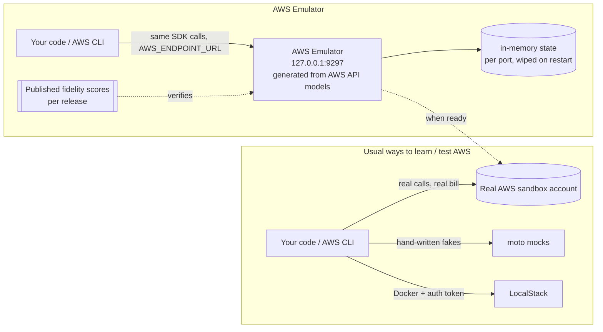
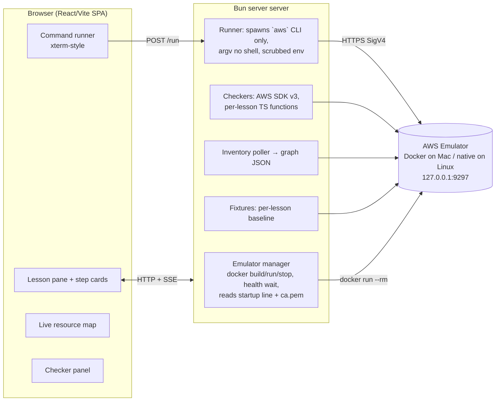

# PLAN: Cloud Dojo

## Goal

A hands-on AWS learning app where every lesson runs real AWS CLI/SDK commands against AWS Emulator (AWS's own local copy of the AWS APIs, in Docker on this Mac), so a learner with no account and no bill can build, break and reset a small cloud.

## Single-user MVP (shipped)

- Lessons 0-7 plus the "Snap Notes" capstone, each with: plain-English concept, goal, real commands, an automatic checker (TypeScript + AWS SDK v3 reading emulator state), a break-it step with AWS's real error, a real-AWS cost and differences note, and a Reset lesson button.
- Bun server that owns the emulator container, an `aws`-only command runner, a live resource map, a Claude tutor panel, an About page with the explainer.
- Progress and tutor conversations in `localStorage` (later moved to a server JSON file in DATA_DIR).

## Explicitly out

AI/Bedrock/AgentCore track (section 7 of the research plan, dropped), stretch lessons 8-10 (EventBridge, Step Functions, observability), CloudFormation/CDK/Terraform/EC2 (low fidelity), multi-user, accounts, persistence beyond localStorage, deploying to real AWS.

## Tasks (vertical slices, in the order built)

1. Emulator: pinned arm64 Docker image, start/health/restart, read this run's keys and cert. (Round trip proven with the CLI and with SDK clients using a per-connection CA agent.)
2. Runner: `aws` only, no shell, env built from scratch, `--profile`/`--endpoint-url`/path escapes refused; tests prove a real-looking parent AWS_PROFILE/AWS_ACCESS_KEY_ID never reaches the child.
3. Lessons 0-7 with fixtures and checkers; `scripts/e2e.ts` replays each lesson's real commands on a fresh emulator and asserts red before and green after.
4. Capstone with a scripted "Show me" solution.
5. Resource map, checker panel, terminal, file viewer, HTTP probe (the runner has no curl).
6. Tutor: server-only Anthropic SDK streaming, context builder, quick-ask chips, Send-to-terminal.
7. About page, README, Impeccable design pass, Playwright screenshots and video, PR.

## Stack

- Bun runtime/package manager/script runner: repo rule.
- Vite + React + TypeScript from `bun create vite`: one SPA, no routing framework needed for four screens.
- Tailwind + shadcn/ui (base-nova preset, Button component) with an AWS-console-style theme (dark first, AWS orange accent), Geist + Geist Mono (self-hosted via Fontsource). The first pine/kraft direction was rejected; see DESIGN.md.
- AWS SDK for JavaScript v3 for checkers/inventory; `@smithy/node-http-handler` with a per-restart `https.Agent({ ca })` so the emulator's regenerated certificate is trusted only for that connection.
- `@anthropic-ai/sdk` for the tutor (server only; default model `claude-opus-5-5`, override with `ANTHROPIC_MODEL`).
- `mermaid` for the About diagrams, loaded lazily.
- `bun test` for runner, tutor and helper tests; `scripts/e2e.ts` for live-emulator lesson tests.

## Deltas found while building (verified on macOS arm64, Docker Desktop, v1.0.341)

- Container restart plus fixture takes about 1-4 s. The emulator writes `ca.pem` and `emulator_credentials` to a bind-mounted folder; the generated `config` file points at container paths, so the app writes its own AWS config.
- A bogus key returns `InvalidClientTokenId` (not the "Sign the request with the emulator credentials" text).
- Direct Lambda invocations do not create a CloudWatch log group; only event-driven invocations do. Lesson 4 reads logs through `--log-type Tail` (the terminal decodes the base64).
- The Lambda runtime's bundled SDK exports only the client class for SNS and SQS, so a handler cannot call `PublishCommand`. The capstone's note announcement is therefore published by the checker, and this is stated in the lesson.
- Resource-based policies are not enforced: removing the API Gateway invoke permission still returns 200. Lesson 7's break-it uses a function that throws (500) instead, and says why.
- The AWS pricing pages render tables with JavaScript; only figures visible in fetched text are quoted exactly (Lambda, DynamoDB on-demand from worked examples, S3 GET, HTTP API). Others are marked approximate.

## Deferred

Stretch lessons 8-10; fidelity badges generated at build time (scores are embedded for v1.0.341 for now); Linux-native emulator mode (`EMULATOR_MODE=native`); AI track; CI.

---

# Research appendix (verified plan, core track)


Research plan (verified on a Linux box against emulator v1.0.341). Kept below as the research appendix; the section directly under this heading is the project plan in the repo's planning-skill shape, with deltas found while building.

Research done 2026-11-13 (Asia/Jerusalem). I installed AWS Emulator **v1.0.341** (released 2026-11-13) as a native Linux binary on the box and ran every lesson's main commands with AWS CLI 2.40.2 and Bun 1.4.4. Results are marked **[verified on box]**. Anything I only read about is marked **[docs]**, and anything I'm unsure of is marked **[unverified]**. Smoke scripts: `/workspace/cloud-dojo/research/t2.sh`, `t3.sh`, `t4.sh`.

---

## 1. What AWS Emulator is

AWS Emulator is AWS's own local copy of the AWS APIs. It launched as generally available on 2026-11-11 ([AWS News Blog](https://aws.amazon.com/blogs/aws/test-your-applications-against-aws-locally-with-aws-emulator/), [product page](https://aws.amazon.com/products/developer-tools/emulator/), [GitHub aws/aws-emulator](https://github.com/aws/aws-emulator), [User Guide](https://docs.aws.amazon.com/emulator/latest/userguide/what-is-service.html)). It is one local program that serves an HTTPS endpoint (`https://127.0.0.1:9297`). The AWS CLI and SDKs talk to it like they talk to AWS. You don't need an AWS account, and there's no bill.

### What makes it unique
- **AWS builds it, and it's generated from AWS's own API models.** Each service is generated from the Smithy model that also produces the AWS SDKs. A new AWS API therefore shows up in the emulator automatically, and its behavior is filled in release by release. Hand-written emulators like LocalStack and moto work differently. ([fidelity doc](https://docs.aws.amazon.com/emulator/latest/userguide/fidelity.html))
- **Fidelity is measured in public.** Every release ships `scores.json.gz` with pass/fail results from fidelity tests that were checked against real AWS. The tests themselves are in [aws-emulator-evaluation-suite](https://docs.aws.amazon.com/emulator/latest/userguide/fidelity.html). Release v1.0.341 has 43,548 test units covering about 354 services. Scores for the services we'd use are in `research/fidelity-core-services.md`: SQS 89%, S3 84%, SNS 84%, EventBridge 86%, Step Functions 78%, API Gateway REST 77%, IAM 73%, DynamoDB 71%, HTTP API 56%, Lambda 50%, CloudFormation 16%.
- **It returns the real errors.** For example, `CreateTable` with name `ab` returns the exact ValidationException that AWS returns [docs]. Operations it doesn't implement return 501 `NotImplemented`.
- **It starts in milliseconds and runs one copy per port.** Each copy has its own keys and in-memory state. A native restart took about **290 ms** [verified on box].
- **It's free.** CC0-1.0, except `vendor/`, which is Apache-2.0. There's no service fee.

### What problem it solves
Learning or testing AWS usually means one of three things: a real account (credit card, surprise bills, cleanup, slow deploys), mocks that drift away from how AWS behaves, or a third-party emulator. AWS Emulator gives AWS-shaped behavior on your laptop with nothing to clean up. AWS even lists "Run workshops and onboarding" and students as use cases on the product page.

### Key limits
| Limit | Detail | Source |
|---|---|---|
| macOS needs Docker | Runs natively only on Linux (RPM/deb, x86_64 and aarch64). On macOS and Windows you **build your own Docker image** from a 7-line Dockerfile, because no image is published. | [Docker guide](https://docs.aws.amazon.com/emulator/latest/userguide/getting-started-docker.html), [setting up](https://docs.aws.amazon.com/emulator/latest/userguide/setting-up.html) |
| In-memory only | State is gone on stop. There is **no reset or snapshot API**. The only control route is `GET /__admin/health`, and the docs say restart to get clean state. | [command reference](https://docs.aws.amazon.com/emulator/latest/userguide/cli-reference.html) |
| IAM is not a security test | "Doesn't evaluate IAM policies… the way AWS does." The emulator's own root key is never denied, and bucket and KMS key policies aren't evaluated. **But** I confirmed that IAM users and roles you create *do* get AccessDenied when no identity policy allows the action. That covers an intern user, and a Lambda execution role writing to DynamoDB [verified on box]. That's enough to teach least privilege, with a clear caveat. | [security](https://docs.aws.amazon.com/emulator/latest/userguide/security.html) |
| One account, one Region | Account `000000000000`. Resources aren't separated by Region. | [what-is](https://docs.aws.amazon.com/emulator/latest/userguide/what-is-service.html) |
| Fidelity varies | Control plane is strongest. Data plane and IaC (CloudFormation, CDK, Terraform) vary. Lambda runtimes are an in-process engine with many open issues; for example, older builds had no bundled SDK. In v1.0.341 the bundled SDK v3 and boto3 both worked [verified on box]. | [fidelity](https://docs.aws.amazon.com/emulator/latest/userguide/fidelity.html), repo `issues/` |
| Test runs, not long-running use | Not tested for long-running or load use. The Docker docs cap memory at 2 GiB, and going over it kills the container (exit code 137) and wipes state. | [what-is](https://docs.aws.amazon.com/emulator/latest/userguide/what-is-service.html), Docker guide |
| Telemetry on by default | Turn it off with `--telemetry off` or `EMULATOR_TELEMETRY=off`. | [README](https://github.com/aws/aws-emulator) |
| Releases are very frequent | It's updated "many times a day". **Pin a version** in the Dockerfile (`https://downloads.aws.com/aws-emulator/packages/aws-emulator/LTS/aws-emulator-<ver>-1-aarch64.rpm`). | [versioning](https://docs.aws.amazon.com/emulator/latest/userguide/versioning.html) |
| Host quirks | Must use `127.0.0.1`, not `localhost`, for S3 path-style addressing. Turn off SDK host prefixes (`AWS_DISABLE_HOST_PREFIX_INJECTION=true`). S3 Control can't reach it. | [point SDK](https://docs.aws.amazon.com/emulator/latest/userguide/point-sdk-to-emulator.html) |

### Pointing tools at it [docs + verified on box]
```bash
export AWS_ENDPOINT_URL=https://127.0.0.1:9297
export AWS_SHARED_CREDENTIALS_FILE=~/.aws/emulator/9297/emulator_credentials   # keys regenerate every start
export AWS_CONFIG_FILE=~/.aws/emulator/9297/config
export AWS_CA_BUNDLE=~/.aws/emulator/9297/ca.pem                                # self-signed cert, regenerated every start
export NODE_EXTRA_CA_CERTS=$AWS_CA_BUNDLE                                       # Node/Bun SDK v3 (Bun 1.4.4 needs this: verified)
export AWS_EC2_METADATA_DISABLED=true AWS_DISABLE_HOST_PREFIX_INJECTION=true AWS_REGION=us-east-1 AWS_DEFAULT_REGION=us-east-1
unset AWS_ACCESS_KEY_ID AWS_SECRET_ACCESS_KEY AWS_SESSION_TOKEN AWS_PROFILE
aws sts get-caller-identity   # → Account 000000000000, arn:aws:iam::000000000000:user/emulator
```
Every request must be SigV4-signed with that run's keys unless the emulator runs with `--auth off`.

### macOS run (Apple silicon), from the docs
```dockerfile
FROM public.ecr.aws/amazonlinux/amazonlinux:2023-minimal
ADD https://downloads.aws.com/aws-emulator/packages/aws-emulator/LTS/aws-emulator-1.0.341-1-aarch64.rpm /tmp/aws-emulator.rpm
RUN rpm -i /tmp/aws-emulator.rpm && rm /tmp/aws-emulator.rpm && mkdir -p /home/emulator && chown 1000 /home/emulator
USER 1000
ENV HOME=/home/emulator
EXPOSE 9297
ENTRYPOINT ["aws-emulator", "-b", "0.0.0.0"]
```
```bash
docker build -t cloud-dojo-emulator .
mkdir -p ~/.aws/emulator
docker run --rm --name cloud-dojo-emu --memory=2g --memory-swap=2g -p 127.0.0.1:9297:9297 \
  -e HOME="$HOME" -v "$HOME/.aws/emulator:$HOME/.aws/emulator" cloud-dojo-emulator -p 9297 --telemetry off
```
Always use `127.0.0.1:` in `-p`. The short form exposes the emulator to the whole network.

### How it compares to the usual approach
| | Real AWS sandbox account | LocalStack | moto | **AWS Emulator** |
|---|---|---|---|---|
| Who builds it | AWS (the real thing) | LocalStack GmbH, hand-written | OSS community, hand-written Python | AWS, generated from SDK API models |
| Cost / signup | Account, card, real bills | Since 2026.03 an **account and auth token are required**. Free "Hobby" tier is non-commercial only, paid tiers for teams ([release](https://blog.localstack.cloud/localstack-for-aws-release-2026-03-0/), [pricing](https://www.localstack.cloud/pricing)) | Free, Apache-2.0 ([docs](https://docs.getmoto.org/en/latest/)) | Free, CC0, no account |
| How you run it | Cloud | Docker | Python decorators in-process, or `moto_server` | Native Linux binary, Docker on macOS/Windows, embedded in Rust |
| Fidelity evidence | 100% | Docs and parity notes | Per-service coverage lists | **Published per-release fidelity scores** vs real AWS |
| IAM enforcement | Real | "IAM tooling" listed in paid plans | Limited, opt-in | Identity policies for created principals, not resource policies, not a security test |
| Persistence | Durable | Snapshots (Cloud Pods) in paid plans | None | None, in-memory, no reset API |
| Speed | Minutes per deploy | Seconds | Instant | Starts in ms, calls in ms |
| Best for | Final verification, security | Broad local dev on Docker | Python unit tests | Learning, CI, agent loops, AWS-accurate errors |



---

## 2. The learning app

**Name / slug:** `cloud-dojo` ("Cloud Dojo: learn AWS on a cloud that can't bill you"). Originally planned as an AWS-branded name; renamed on 2026-11-15 so "AWS" is not part of the product name (see CHANGELOG.md).

**Core loop per lesson:** Read why → run real `aws` commands → **Check** turns green as the emulator state changes → **Break it** (trigger a real AWS error on purpose and read it) → **Real AWS notes** (cost and differences) → **Reset lesson**.

### 2.1 Lesson path (all services verified working on v1.0.341 on the box)

Every lesson starts from a **fixture**, a known baseline the server creates with the SDK right after a fresh emulator start. A learner can therefore jump in anywhere and reset at any point.

| # | Lesson | Goal | Learner runs (abridged; real commands) | Auto-checker (inspects emulator state) | Break it | Real AWS cost / difference note |
|---|---|---|---|---|---|---|
| 0 | **Lift-off: accounts, Regions, credentials** | Understand endpoints, credentials, account IDs, and Regions. Prove you're talking to the emulator. | `aws sts get-caller-identity`; `aws configure list` | Command history shows a successful `GetCallerIdentity` with Account `000000000000` | Run with a bogus key → `AccessDenied "Sign the request with the emulator credentials"` | Real AWS has many Regions and isolated accounts. The emulator is one account and one Region. Real credentials should never be root keys; use IAM Identity Center. |
| 1 | **IAM: users, policies, least privilege** | Make an `intern` user who can only read S3 objects | `aws iam create-user --user-name intern`; `aws iam put-user-policy … s3:GetObject`; `aws iam create-access-key`; run `aws s3api delete-object` as intern | User exists. Policy allows only `s3:Get*`. `simulate-principal-policy` says GetObject=allowed and DeleteBucket=implicitDeny [verified] | As intern: `delete-object` → `AccessDenied … no identity-based policy allows s3:DeleteObject` [verified] | IAM is free. The **emulator doesn't evaluate resource policies or the root key**, so always test real security on AWS. |
| 2 | **S3: buckets, objects, versioning** | Store files and recover an overwritten one | `aws s3api create-bucket`; `put-bucket-versioning Status=Enabled`; `aws s3 cp` twice; `list-object-versions`; `get-object --version-id` | Bucket exists, versioning `Enabled`, key has ≥2 versions, restored file matches v1 [create/versioning/cp verified] | `create-bucket --bucket AB` → `InvalidBucketName` [verified] | About $0.023/GB-month for Standard in us-east-1, plus per-request fees. Bucket names are global on real AWS. |
| 3 | **DynamoDB: tables, keys, conditional writes** | Model `Notes` (pk/sk), write, query, and prevent overwrites | `create-table … PAY_PER_REQUEST`; **`aws dynamodb wait table-exists`**; `put-item`; `query`; `put-item --condition-expression attribute_not_exists(pk)` | Table ACTIVE with the right key schema and on-demand mode, ≥3 items, query on one pk returns ≥2 | Write before the table is ACTIVE → `ResourceNotFoundException` (the emulator really models CREATING→ACTIVE) [verified]; duplicate put → `ConditionalCheckFailedException` [verified] | On-demand pricing is per million read/write request units. There are no servers to size. |
| 4 | **Lambda: functions, roles, logs** | Deploy a Node handler, invoke it, read logs, then let it write to DynamoDB | write `index.mjs`, zip it; `iam create-role` with trust `lambda.amazonaws.com`; `lambda create-function --runtime nodejs22.x`; `lambda wait function-active-v2`; `lambda invoke --log-type Tail`; `logs filter-log-events` | Function Active, runtime `nodejs22.x`, role trust correct. Checker invokes it with a probe payload and expects the right output. Item written to `Notes`. | Invoke the SDK-writing version before adding a role policy → `AccessDeniedException … assumed-role/lambda-exec/… dynamodb:PutItem` [verified]. Fix with a scoped `put-role-policy`. | Free tier is 1M requests and 400k GB-s per month. After that it's pay per request and GB-second. Real cold starts and timeouts differ, and the emulator runs code in an in-process runtime. |
| 5 | **Messaging: SQS queues + SNS fan-out** | One `order-events` topic fans out to two queues | `sqs create-queue` ×2; `sns create-topic`; `sns subscribe --protocol sqs`; `sqs set-queue-attributes Policy=…` (allow sns.amazonaws.com with SourceArn); `sns publish`; `sqs receive-message` | Topic has 2 SQS subscriptions, both queue policies allow the topic. Checker publishes a probe and sees it in **both** queues. | Skip the queue policy → publish succeeds but the message **never arrives** (silent failure, just like AWS) [verified] | SQS and SNS each have a 1M request/month free tier, then pennies per million. |
| 6 | **Event wiring: S3 → SQS → Lambda** | Uploading a photo triggers a worker function | `put-bucket-notification-configuration` (QueueConfigurations); `iam attach-role-policy AWSLambdaSQSQueueExecutionRole`; `lambda create-event-source-mapping --batch-size 1` | Notification config exists, ESM Enabled. Checker uploads a probe object and waits for the worker's log line `got 1 records` [verified end to end] | Notification without queue policy → `InvalidArgument: Unable to validate the following destination configurations` [verified]; ESM without role perms → `InvalidParameterValueException … ReceiveMessage` [verified]. Notice the `s3:TestEvent` message, which real AWS also sends [verified]. | Event-driven means nothing runs and nothing bills until an event arrives. |
| 7 | **API Gateway: a public HTTP endpoint** | `GET /notes` served by Lambda | `lambda add-permission --principal apigateway.amazonaws.com`; `apigatewayv2 create-api --protocol-type HTTP --target <lambda arn>`; `curl --cacert … <ApiEndpoint>/` | API exists with `$default` stage, Lambda permission present. Checker GETs the URL and expects 200 plus JSON [verified: the endpoint is `https://127.0.0.1:9297/_aws/execute-api/<apiId>`] | Remove the permission → 500 at the stage | HTTP APIs cost about $1 per million requests. Real endpoints are `https://<id>.execute-api.<region>.amazonaws.com`. |
| 8 | **EventBridge: rules and patterns** (stretch) | Route only orders over $100 to an `audit` queue | `events put-rule --event-pattern '{"detail":{"total":[{"numeric":[">",100]}]}}'`; `put-targets`; queue policy for events.amazonaws.com; `put-events` | Checker sends one $250 event and one $5 event. Exactly 1 lands in `audit` [verified] | Typo in the pattern → nothing matches | Custom events are about $1 per million. |
| 9 | **Step Functions: orchestration** (stretch) | A state machine that calls the Lambda function | `iam create-role` (states.amazonaws.com); `stepfunctions create-state-machine` (`arn:aws:states:::lambda:invoke`); `start-execution`; `describe-execution` | Execution `SUCCEEDED` with the expected output [verified] | Role without `lambda:InvokeFunction` → execution FAILED [unverified] | Standard workflows bill per state transition. |
| 10 | **Observability: logs and alarms** (stretch) | Find a failing invocation and alarm on errors | `logs filter-log-events`; `cloudwatch put-metric-alarm --metric-name Errors` | Alarm exists on `AWS/Lambda Errors` for `worker` [create verified; state may stay `INSUFFICIENT_DATA`, so flag the alarm state transition as **unverified**] | Throw in the handler → `FunctionError: Unhandled` in invoke | Alarms are about $0.10 each per month, and log ingestion is per GB. |
| ★ | **Capstone: "Snap Notes" serverless app** | Wire it all together: HTTP API `POST /notes` → Lambda → DynamoDB; photo upload → S3 → SQS → worker Lambda writes metadata; SNS fan-out "note created" to 2 queues | Learner builds it from a spec card with hints, or presses "show me", which runs a scripted solution step by step | End-to-end probe: POST a note → item in table; upload a photo → metadata item in under 10 s; SNS reaches both queues; every IAM role is least-privilege (simulate-principal-policy) | — | Rough real monthly cost estimate for 10k notes/month (all free tier). The README also explains how to deploy the same thing to a real account later (out of scope). |

The **MVP is lessons 0–7 plus the Capstone**. Lessons 8–10 are stretch and can be cut if time runs short. CloudFormation, CDK, Terraform, and EC2 are left out on purpose because their fidelity is low (CFN 16%, EC2 45%).

Cost numbers are list prices for us-east-1 that I remember. **Re-check every figure against aws.amazon.com/<service>/pricing during the build and show an "as of" date.**

### 2.2 Architecture



- **The Bun server owns the emulator.** On boot it checks `docker version`. If the pinned image `cloud-dojo-emulator:<ver>` is missing, it builds it from `emulator/Dockerfile`. Then it runs the container (as in §1, `--telemetry off`, `--memory=2g`, publish on `127.0.0.1` only), polls `/__admin/health`, and parses the JSON startup line for `endpoint_url` and `ca_file`. On Linux it can spawn the native `aws-emulator` instead (`EMULATOR_MODE=native|docker`).
- **Reset lesson** = stop the container, start a fresh one, then apply that lesson's fixture. This is the only clean reset the emulator supports, since there's no reset route. A native restart took 290 ms on the box; Docker on Mac should take a few seconds [unverified]. A UI toast shows "Fresh cloud in 1.8 s".
- **The cert and keys change on every restart.** The SDK clients in the Bun server must be rebuilt after each restart with an explicit `https.Agent({ ca: readFileSync(ca_file) })` through `@smithy/node-http-handler`. `NODE_EXTRA_CA_CERTS` is only read when the process starts. The CLI re-reads `AWS_CA_BUNDLE` and the credentials file on every call, so it's fine. Use `forcePathStyle: true` for S3. [Bun + SDK v3 + NODE_EXTRA_CA_CERTS verified; the per-restart agent swap is **unverified**, so test it first.]
- **Command runner (safety-critical, since Danny's Mac may hold real AWS credentials):** the server runs only the `aws` binary, using `Bun.spawn(["aws", ...argv])` with no shell. Args are tokenized with `shell-quote`, and pipes and `&&` are rejected. The env is **rebuilt from scratch**: emulator endpoint, credentials, config, and CA, with `AWS_PROFILE`, `AWS_ACCESS_KEY_ID`, and the rest removed, plus `AWS_PAGER=""`. `--endpoint-url`, `--profile`, and `--no-verify-ssl` are refused. The cwd is a per-lesson scratch dir `~/.cloud-dojo/work/<lesson>/`, which holds starter files such as `index.mjs`. A server-side "zip it" helper button covers zipping. Each lesson also shows the learner the `export …` block so they can use their own terminal; the checkers work either way because they read state, not history (except lesson 0).
- **Checkers** are small TypeScript functions per lesson (`lessons/<id>/check.ts`). Each returns `[{ id, label, pass, hint }]`. They run on "Check" and auto-poll every 2 s while a lesson is open. Each one reads state (`GetBucketVersioning`, `DescribeTable`, `GetFunction`, `GetQueueAttributes`, `ListSubscriptionsByTopic`, `ListEventSourceMappings`, `GetApis`, `SimulatePrincipalPolicy`, …), and the end-to-end probes push a probe message or object and wait. Probe resources are tagged and cleaned up afterwards.
- **Live resource map:** the inventory poller (every 2 s, and after each command) lists buckets, tables, functions, queues, topics, subscriptions, ESMs, bucket notifications, APIs, rules and targets, state machines, roles, and users. It returns `{nodes, edges}`, which the UI renders with React Flow (`@xyflow/react`) as service "cards" with AWS-style glyphs. Edges come from real config, such as SNS→SQS subscriptions, S3→SQS notifications, SQS→Lambda ESMs, API→Lambda integrations, and Role→Function. New nodes pulse in. Clicking a node shows its raw describe JSON. The emulator has no GUI, so this map *is* the "console".
- **Fidelity badge per lesson:** a build script (`scripts/fidelity.ts`) downloads the pinned release's `scores.json.gz` and writes `fidelity.json`. Each lesson then shows something like "S3 1025/1226 AWS-verified tests pass in v1.0.341".
- **Progress** is saved in `localStorage` plus `~/.cloud-dojo/progress.json`.

**Layout:** `{server/, web/, lessons/<nn-slug>/{lesson.md, fixture.ts, check.ts, starter/}, emulator/Dockerfile, scripts/, README.md}`. Scripts: `bun run dev` (server and Vite), `bun run emulator:build`, `bun test` (checkers tested against a real emulator in CI on Linux natively, using the box-style install).

### 2.3 Screens
1. **Home:** lessons table in a console-style container with status indicators, an emulator status pill in the top bar (Docker → image → healthy → port) and a "Reset lesson" button per lesson.
2. **Lesson:** left is the narrative and step cards. Center is the command runner with copy buttons on each command. Right is the live resource map above the checker list. The bottom drawer holds the "Real AWS notes" (cost and differences).
3. **About:** what AWS Emulator is, why it's unique, the comparison table, both mermaid diagrams (rendered with `mermaid`), limits, and links.
4. **Capstone:** a spec card checklist with the full architecture map lighting up as each part passes.

### 2.4 Design (Impeccable skill)
Run Claude Code with the Impeccable skill. **Superseded:** the original pine/kraft/crayon palette was rejected ("should look more modern, like tech companies, way more similar to AWS"). The shipped direction is an AWS-console / Cloudscape-adjacent developer product: dark first (`#0b1521` canvas), AWS orange `#ff9900` as the single accent, blue links, green/red for check status only, Geist + Geist Mono, a docked assistant panel and an architecture-style resource map. Full spec in DESIGN.md.

---

## 3. Deliverables required by Danny's standing rules
- **"What makes it unique / problem / comparison + mermaid"** goes into: README (top section), the in-app About page (same content, rendered), the PR body, and the chat summary. Use §1 above as the source text.
- **PR:** branch `demo/cloud-dojo` → `main`. It needs **≥1 screenshot** (lesson 6 with the live map showing S3→SQS→Lambda and green checks) and **≥1 video**: a 60–90 s Playwright-recorded walkthrough of a fresh start → lesson 2 (create bucket, map pulses, versioning check goes green) → Break it error → Reset → capstone map lighting up. Optionally add a voiceover and subtitles with the ElevenLabs/ffmpeg pipeline used for the WebMCP explainer.
- Repo rules: never read or commit `.env.local` or any API key, never force-push, build with Bun.

## 4. Build order (for Claude Code)
1. `emulator/` Dockerfile (pinned) and emulator manager with health wait, startup-line parse, and restart. Prove the `get-caller-identity` round trip from Bun on the Mac.
2. Runner with env scrubbing, plus tests showing `--profile` and `--endpoint-url` are refused and real credentials are never inherited.
3. Inventory poller, graph JSON, and React Flow map.
4. Lessons 0–4, each with fixture, check, and starter files, plus checker tests against a live emulator.
5. Lessons 5–7, then the Capstone, then stretch lessons 8–10.
6. About page, README, fidelity badge, and Impeccable polish.
7. Screenshot and video, then open the PR.

## 5. Open questions / risks
1. **Docker on Danny's Mac.** The emulator does **not** run natively on macOS. Need to check `docker version` (Docker Desktop, OrbStack, or Colima) and the CPU type (assume Apple silicon → aarch64 rpm). If there's no Docker, options are installing OrbStack or Colima (needs Danny's OK) or running the native binary on a Linux VM or the box.
2. **AWS CLI v2 on the Mac.** It needs to be installed; I verified with 2.40.2. The docs' agent-skill path needs ≥2.35.0, and the plain CLI only needs `AWS_ENDPOINT_URL` support.
3. **Real AWS credentials on the Mac** could leak into lesson commands. Mitigation is the scrubbed env and refused flags; this is the main safety requirement.
4. **Restart latency in Docker** and the 2 GiB memory cap are unverified on the Mac.
5. **Fidelity drift.** It ships many releases a day and behavior changes, so pin `1.0.341`. Lambda is the weakest core service (50%): the in-process runtime has open issues with stdlib gaps and module resolution. Keep handlers tiny and free of dependencies, and only use the bundled SDK.
6. **IAM caveat.** Created principals are enforced; the root emulator key and resource policies are not. The lessons must say so plainly so Danny doesn't learn wrong security lessons.
7. **CloudWatch alarm state changes and Step Functions failure paths** weren't verified. Treat them as stretch and drop them if they're flaky.
8. **Cost figures** are from memory and need re-checking against the AWS pricing pages during the build.
9. **Telemetry:** default it off in our launcher and say so in the README.

## 6. Research artifacts on the box
- `/workspace/cloud-dojo/research/`: doc text dumps (`cli-reference.txt`, `point-sdk-to-emulator.txt`, `security.txt`, `what-is-service.txt`, `versioning.txt`, …), `README.md` (repo README), `fidelity-core-services.md`, `scores.json` (v1.0.341 raw), and smoke scripts `env.sh`, `t2.sh`, `t3.sh`, `t4.sh` (DynamoDB, SNS/SQS, S3 notifications, ESM, Lambda SDK + IAM denial, HTTP API, Step Functions, EventBridge, CloudWatch).
- The box has `aws-emulator` 1.0.341 (deb) and AWS CLI 2.40.2 installed. The emulator is stopped.

---


## v2 / M1 (this branch)

Scope, from the v2 plan (kept outside the repo): tracks → modules → steps with honesty badges, a capability probe, predict-then-run concept checks, track exams, server-side progress, a starter-file editor, a generalised HTTP probe, the resource-policy content fix, and two deep tracks (DynamoDB 3.2-3.7, SQS+SNS 5.2-5.6). No voice assistant work: the Claude text tutor stays, with its prompt updated for the module structure and the corrected policy facts.

Done when: `bun test`, lint and build pass; `bun run test:e2e` takes every module from not-green to green on a fresh emulator and grades every quiz; screenshots and the walkthrough video are re-captured. Next: M2 (IAM, S3, Lambda) and M3 (API Gateway, Step Functions, EventBridge, CloudWatch, KMS).


## v2 scope (M1 to M4, shipped on this branch)

- Tracks and modules (61 modules in 12 tracks) with honesty badges from a capability probe, predict-then-run, track exams, a starter-file editor and an HTTP probe.
- New tracks: API Gateway, Step Functions, EventBridge and Scheduler, CloudWatch (with a mini dashboard), KMS / Secrets Manager / Parameter Store.
- Capstone v2 scored as a mini Well-Architected review; timed mixed exam mode with per-domain readiness.
- Provider-agnostic bring-your-own-key tutor chat (browser-only key, optional env fallback).
- Local-first progress with export and import; open-source readiness (MIT, SECURITY, CONTRIBUTING, license notes, secret scan).
