# Cloud Dojo

> A hands-on AWS course you run locally on the AWS emulator.

> **Cloud Dojo is an independent open-source project. It is not affiliated with, endorsed by, or sponsored by Amazon Web Services, Inc. or its affiliates. Amazon Web Services, AWS, and the names of AWS services are trademarks of Amazon.com, Inc. or its affiliates.**

Learn by doing. 61 hands-on modules in 12 tracks run real `aws` CLI commands against **AWS Emulator**, a local copy of the AWS APIs published by AWS (CC0-1.0, vendored parts Apache-2.0; see [Credits](#credits-and-trademarks)), in Docker on your machine. No AWS account, no bill, nothing to clean up, and a fresh cloud one click away.

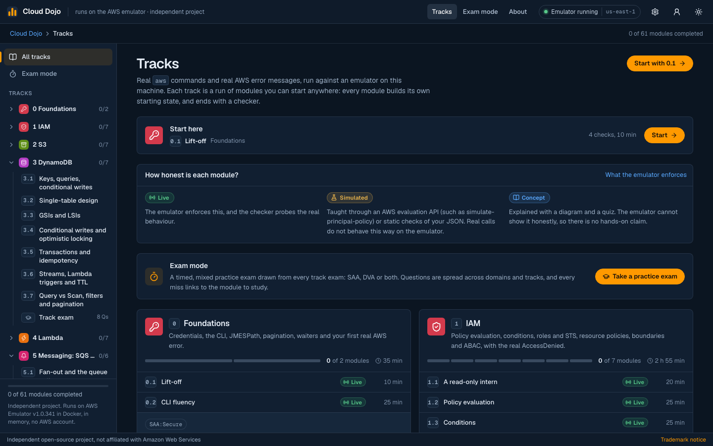

## Quick start

Requirements: [Bun](https://bun.sh), [Docker](https://www.docker.com/products/docker-desktop/) running, AWS CLI v2 on `PATH`. macOS or Linux.

```bash
git clone https://github.com/dannyavrs/cloud-dojo.git && cd cloud-dojo
bun install
bun run dev        # API server on :4747, UI on http://127.0.0.1:5173 (your real session)
```

The first run builds a pinned emulator image `cloud-dojo-emulator:1.0.341` (about a minute). No API key is needed for anything except the optional tutor chat (see [Tutor chat](#tutor-chat-optional-bring-your-own-key)). A Docker route that runs the whole app is below under [Run it](#run-it).

**Design:** an AWS-console-style developer product (dark first, light available): top bar and breadcrumbs, a side nav grouped by track, console containers, status indicators, a split workbench (checker, resource map, terminal) and a docked Tutor panel. AWS orange is the only accent; no AWS logo or icon artwork is used, and "on AWS Emulator · not affiliated with AWS" stays visible. Spec: [DESIGN.md](DESIGN.md).

## What is AWS Emulator, and why this app uses it

**What makes it unique**

- **AWS builds it, generated from the same API models as the SDKs** (Smithy), so new APIs appear automatically and responses have the shape SDKs expect.
- **Real AWS error messages** (`InvalidBucketName`, `ConditionalCheckFailedException`, `AccessDenied` naming the exact action).
- **Published fidelity.** Every release ships per-service scores from tests checked against real AWS. v1.0.341: SQS 89%, S3 84%, SNS 84%, EventBridge 86%, IAM 73%, DynamoDB 71%, HTTP APIs 56%, Lambda 50%, CloudFormation 16%.
- **Free**: CC0-1.0 (vendored code Apache-2.0), no account, no token. Details and what that means for a public project: [docs/OPEN-SOURCE-NOTES.md](docs/OPEN-SOURCE-NOTES.md).

**The problem it solves.** Learning or testing AWS normally needs a real account (card, surprise bills, cleanup, slow deploys), mocks that drift from AWS, or a third-party emulator. This gives AWS-shaped behavior on a laptop with instant reset, so you can break things on purpose.

**How it compares**

| | Real AWS sandbox account | LocalStack | moto | **AWS Emulator** |
|---|---|---|---|---|
| Who builds it | AWS | LocalStack GmbH, hand-written | OSS community, hand-written Python | AWS, generated from SDK API models |
| Cost / signup | Account, card, real bills | Since March 2026 an account and auth token are required; free tier non-commercial | Free, Apache-2.0 | Free, CC0, no account |
| Run it | Cloud | Docker | In-process Python or a mock server | Native on Linux; Docker on macOS/Windows |
| Fidelity evidence | It is AWS | Docs, parity notes | Coverage lists | Published per-release scores vs real AWS |
| IAM enforcement | Real | Paid plans | Limited, opt-in | Identity policies plus S3, Lambda, SQS and KMS resource policies (tested); not DynamoDB resource policies, permission boundaries or tag conditions; not a security test |
| Persistence | Durable | Snapshots in paid plans | None | None: in-memory, restart to reset |
| Best for | Final verification, security | Broad local dev | Python unit tests | Learning, CI, AWS-accurate errors |

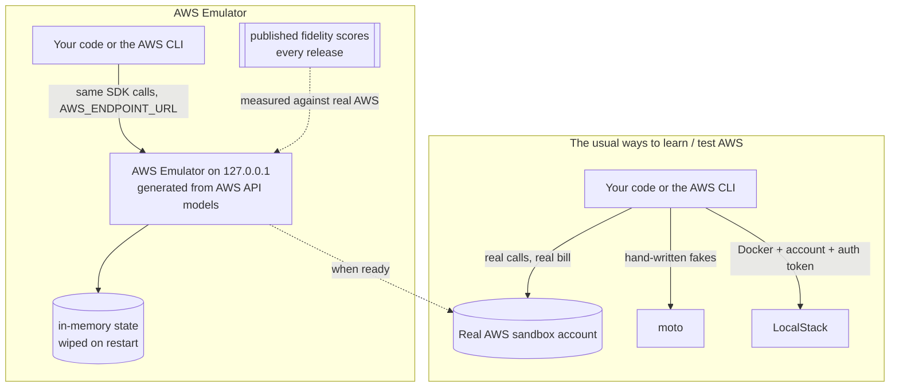

**Honest limits.** In-memory only (state is gone on restart, there is no reset API). Not a security test: identity policies and S3 bucket, Lambda, SQS and KMS key policies are enforced (we tested each on 1.0.341), but DynamoDB resource policies, permission boundaries and tag conditions are not applied to real calls, and the emulator's root key is never denied. One account (`000000000000`), one Region. Lambda is about 50% parity. For testing and learning, not production or load. Docker is required on macOS.

The same explainer is in the app: open **About** (the first thing a new visitor sees).

## Tracks and modules

61 modules in 12 tracks: **56 Live, 3 Simulated, 2 Concept**. **Every module is independent**: its fixture seeds what it needs, so you can start anywhere, and **Reset module** rebuilds that starting state. Each module opens with 1 to 3 **predict-then-run** questions, has a hands-on task with an automatic checker, an on-purpose failure (**break it**), a "real AWS: cost and differences" note, and exam-domain tags (SAA / DVA). Tracks end with a 6 to 10 question track exam. Quizzes are graded locally with fixed answer keys: no model is involved. The badge comes from what the emulator really does: a **capability probe** runs once per emulator image, and a Simulated or Concept module flips to Live on its own if a newer emulator starts enforcing the behaviour.

| Module | Level | Honesty | Note |
|---|---|---|---|
| **Track 0: Foundations** | | |  |
| 0.1 Lift-off | core | Live | Prove you are talking to AWS Emulator, and learn who AWS thinks you are. |
| 0.2 CLI fluency | intermediate | Live | Read any AWS response like a pro, and know why the CLI sometimes prints None. |
| **Track 1: IAM** | | | exam: 8 questions |
| 1.1 IAM | core | Live | Give someone exactly the access they need, then watch AWS refuse everything else. |
| 1.2 Policy evaluation logic | intermediate | Live | Allow everything on S3, deny one action in a second policy, and read the verdict from IAM itself. |
| 1.3 Conditions | intermediate | Live | The `s3:prefix` condition is enforced on real calls and simulated with --context-entries. `aws:SourceIp` is only shown through simulate: on real calls |
| 1.4 Roles, trust policies and STS | intermediate | Live | Roles, trust policies and AssumeRole are enforced. Session policies (`--policy` on assume-role) are NOT: the emulator accepts the argument but does no |
| 1.5 Resource-based policies | advanced | Live | S3 bucket policies, SQS queue policies, Lambda resource policies and KMS key policies are enforced on this emulator (hands-on here: S3 and SQS). Dynam |
| 1.6 Permission boundaries and safe delegation | advanced | **Simulated** | This module teaches permission boundaries through `simulate-principal-policy`, which evaluates them correctly. A real call on the emulator ignores the |
| 1.7 ABAC | advanced | **Concept** | The emulator does not match `aws:PrincipalTag`, `aws:ResourceTag` or `${aws:username}`-style variables on real calls (they are denied even when they s |
| **Track 2: S3** | | | exam: 8 questions |
| 2.1 S3 | core | Live | Overwrite a file by accident, then get the old one back. |
| 2.2 Presigned URLs | intermediate | Live | Hand out one private object for five minutes, then watch it stop working. |
| 2.3 Multipart upload | intermediate | Live | Upload a 6 MiB object in two parts, trip the 5 MiB rule, then clean up the parts nobody can see. |
| 2.4 Event notifications | intermediate | Live | Send only uploads/*.jpg to a queue, and learn why S3 refuses to wire it up until the queue says yes. |
| 2.5 Lifecycle rules and storage classes | advanced | **Simulated** | The emulator stores lifecycle rules but never runs them, and it accepts transitions that real S3 rejects (it only catches an expiration that is not la |
| 2.6 Data protection | advanced | Live | SSE-KMS, default encryption with bucket keys, Block Public Access and Object Lock (including the Governance bypass) are enforced on the emulator and c |
| 2.7 Replication and conditional writes | advanced | Live | Replication works on the emulator within one region only (same-region replication). Cross-region replication, Replication Time Control and cross-accou |
| **Track 3: DynamoDB** | | | exam: 8 questions |
| 3.1 DynamoDB | core | Live | Model a Notes table, query it, and stop a write from clobbering another. |
| 3.2 Single-table design | intermediate | Live | One table, composite keys, and item collections that answer a question in a single request. |
| 3.3 GSIs and LSIs | intermediate | Live | Same data, a second sort order, a different partition key, and the rules that bite on the exam. |
| 3.4 Conditional writes and optimistic locking | intermediate | Live | Stop two clients from overwriting each other without taking a lock. |
| 3.5 Transactions and idempotency | advanced | Live | Move money between two items all-or-nothing, and make a retry safe. |
| 3.6 Streams, Lambda triggers and TTL | advanced | Live | Streams and the Lambda trigger behave as on AWS. TTL deletes within about 15 seconds here; on AWS expect a delay of hours to days. |
| 3.7 Query vs Scan, filters and pagination | intermediate | Live | What you pay for is what DynamoDB reads, not what it returns. |
| **Track 4: Lambda** | | | exam: 8 questions |
| 4.1 Lambda | core | Live | Deploy code, call it, read its logs, and fix the permission it is missing. |
| 4.2 Lambda configuration and error shapes | intermediate | Live | Configuration, FunctionError, timeouts and log tails are enforced by the emulator. Cold versus warm starts and real latency cannot be shown: every inv |
| 4.3 Versions, aliases and a weighted canary | advanced | Live | Versions, aliases and weighted routing are enforced by the emulator, including the immutability of published versions. CodeDeploy-driven rollouts and  |
| 4.4 Lambda layers | intermediate | Live | Publishing, attaching and removing layers is enforced and the layer contents are really mounted for the handler. Real Node.js ES modules resolve layer |
| 4.5 Concurrency | advanced | Live | Reserved concurrency and the TooManyRequestsException throttle are enforced for real. Provisioned concurrency is COSMETIC here: the configuration is a |
| 4.6 Function URLs and the resource policy that opens them | intermediate | Live | The Function URL, its 403 without a resource policy and the 200 after add-permission are enforced by the emulator. The emulator opens the URL after th |
| 4.7 Async invocation, destinations and DLQs | advanced | **Concept** | CONCEPT module: the emulator accepts the event invoke config, destinations and DLQ settings but delivers nothing to them. The check is a static review |
| **Track 5: Messaging: SQS and SNS** | | | exam: 9 questions |
| 5.1 SQS + SNS | core | Live | One event, two queues, and the silent failure that bites everyone once. |
| 5.2 Visibility timeout, long polling and delay queues | intermediate | Live | At-least-once delivery, felt in your hands: why a message you forgot to delete comes back. |
| 5.3 Dead-letter queues and redrive | intermediate | Live | Quarantine the poison message, then replay it when the bug is fixed. |
| 5.4 FIFO queues | intermediate | Live | Exactly-once-ish processing, in order, and the single-lane rule that limits it. |
| 5.5 SNS filter policies and selective fan-out | advanced | Live | One topic, many consumers, and each one receives only the messages it asked for. |
| 5.6 SQS to Lambda at scale | advanced | Live | The event source mapping, batching and partial batch responses run for real. Scaling behaviour under heavy load is not representative. |
| **Track 7: API Gateway** | | | exam: 9 questions |
| 7.1 API Gateway | core | Live | Put a URL in front of a Lambda function. |
| 7.2 Routes, stages and stage variables | intermediate | Live | Route matching, stages, stage variables and auto-deploy are all enforced by the emulator. It answers 403 (not 404) for a stage that has no deployment  |
| 7.3 A Lambda authorizer with simple responses | advanced | Live | The emulator runs your authorizer function, enforces the simple-response contract, passes `context` to the backend and caches decisions. It does not e |
| 7.4 JWT authorizer with Cognito | advanced | Live | The emulator issues real RS256 Cognito-style tokens and its JWT authorizer verifies issuer, audience (or client_id) and scopes, and passes the claims  |
| 7.5 Throttling and CORS | intermediate | Live | The emulator enforces stage throttling with a token bucket (rate and burst) and returns 429, and it answers CORS preflights with the allow-origin, all |
| 7.6 REST API | advanced | Live | The emulator enforces API key requirement and usage-plan quotas on a REST API: no key or an unattached key gets 403, and the call after the quota gets |
| **Track 8: Step Functions** | | | exam: 8 questions |
| 8.1 First workflow | intermediate | Live | The emulator runs real Standard executions: Task states invoke the Lambda, Retry waits and backs off, the execution history records every attempt, and |
| 8.2 Catch, Fail and ResultPath | intermediate | Live | Catch, ResultPath, DynamoDB service integration and the Fail state all run for real in the emulator, and the JSONPath errors you get from a bad Result |
| 8.3 Map, Choice, Wait and a direct DynamoDB integration | advanced | Live | Inline Map, Choice, Wait and the DynamoDB service integration all execute in the emulator, including `$$.Map.Item.Value`, intrinsic functions and exec |
| 8.4 Human approval with waitForTaskToken | advanced | Live | The callback pattern runs for real: the execution parks at RUNNING, the task token arrives in SQS, and send-task-success or send-task-failure resumes  |
| 8.5 Express workflows, synchronous runs and JSONata | advanced | Live | Express machines, start-sync-execution, JSONata (Output, Assign, Condition) and test-state for non-Task states all work, and the Standard-only operati |
| **Track 9: EventBridge and Scheduler** | | | exam: 9 questions |
| 9.1 Event wiring | intermediate | Live | Upload a photo and a worker function runs on its own. |
| 9.2 Event buses and content-based routing | intermediate | Live | Custom buses, rules, pattern matching, `test-event-pattern` and SQS targets (including the queue access policy) all behave like AWS here. Verified on  |
| 9.3 Targets with roles | intermediate | Live | The emulator enforces both target permission models here: the role trust and its `states:StartExecution` permission for Step Functions, and the functi |
| 9.4 EventBridge Scheduler | intermediate | Live | One-off `at()` and recurring `rate()` schedules really fire on the emulator, the scheduler role trust is validated at create time, and the role permis |
| 9.5 Archive and replay | advanced | Live | Archives really record events and `start-replay` really re-delivers them to the bus with a `replay-name` field, including the `FilterArns` restriction |
| **Track 10: CloudWatch** | | | exam: 10 questions |
| 10.1 Custom metrics and statistics | intermediate | Live | The emulator stores and aggregates custom metrics for real: namespaces, dimensions, statistics, percentiles, metric math, and the same input validatio |
| 10.2 Alarms to SNS | intermediate | Live | Alarms really evaluate on their own: the emulator moves them between OK, ALARM and INSUFFICIENT_DATA from the metric data, honours treat-missing-data, |
| 10.3 Logs | intermediate | **Simulated** | Retention and metric-filter configuration are stored faithfully. Whether a filter really emits metric data and whether Logs Insights returns real rows |
| 10.4 Dashboards | intermediate | Live | The emulator stores dashboards and validates part of the body (metric widgets need a region). It has no console, so this app draws the stored body its |
| **Track 11: KMS, Secrets Manager, Parameter Store** | | | exam: 8 questions |
| 11.1 KMS basics and envelope encryption | intermediate | Live | The emulator runs real KMS semantics for symmetric keys: aliases, encrypt/decrypt, data keys, re-encrypt and the encryption-context check are all enfo |
| 11.2 Key policies, grants, rotation and deletion | advanced | Live | The emulator evaluates KMS key policies (including explicit Deny and the root-delegation statement), grants, rotation settings and key states for real |
| 11.3 Secrets Manager | advanced | Live | Secrets Manager versions and staging labels are real, and rotation really invokes your Lambda through the four steps. The emulator enforces the Lambda |
| 11.4 Parameter Store | intermediate | Live | Parameter Store behaves like AWS for what this module teaches: String and SecureString types, hierarchies and by-path reads, versions, overwrite rules |
| **Track ★: Capstone** | | |  |
| ★ Capstone | advanced | Live | Build a small serverless app from a spec card, then see it scored as a mini Well-Architected review. |
Not covered, on purpose: CloudFormation/CDK/Terraform (emulator fidelity 16%), EC2/VPC networking (45%), cross-account and multi-Region designs, SCPs. They stay quiz-only or out of scope.

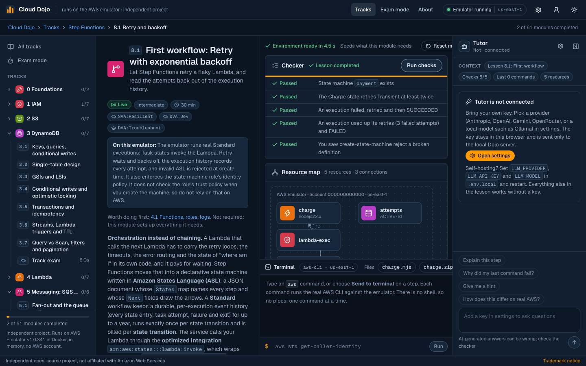

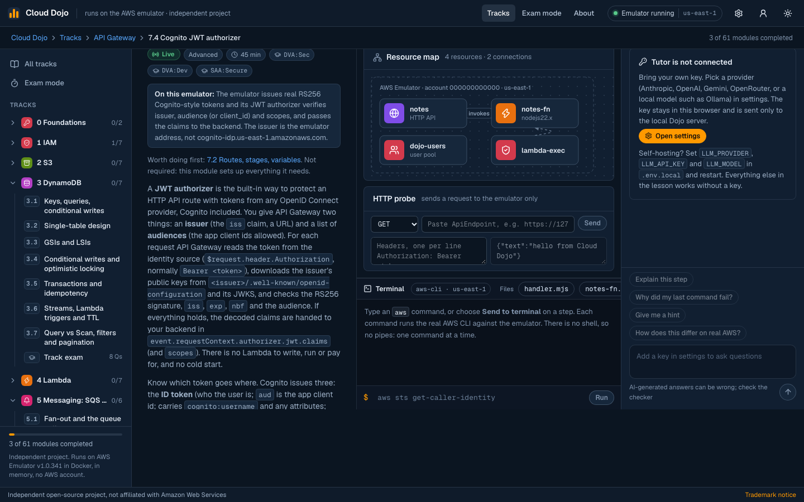

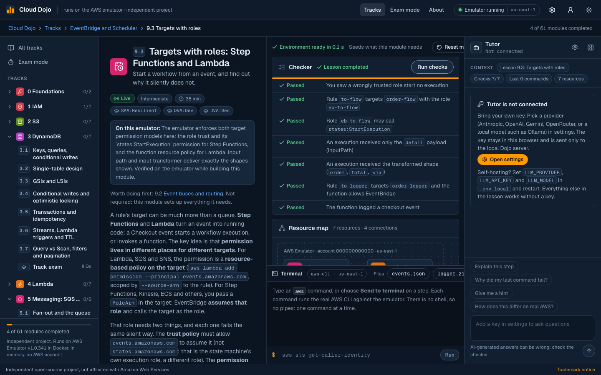

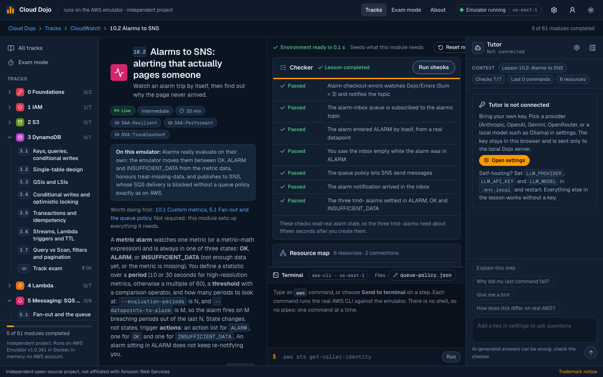

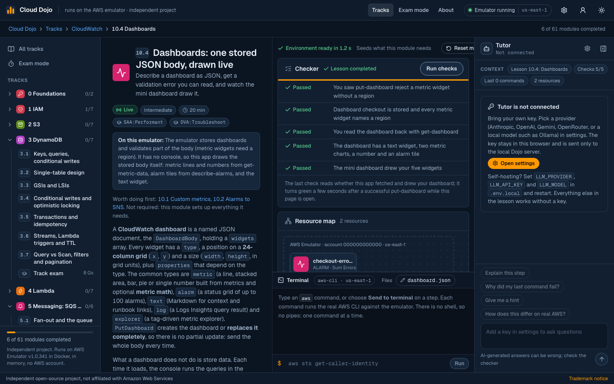

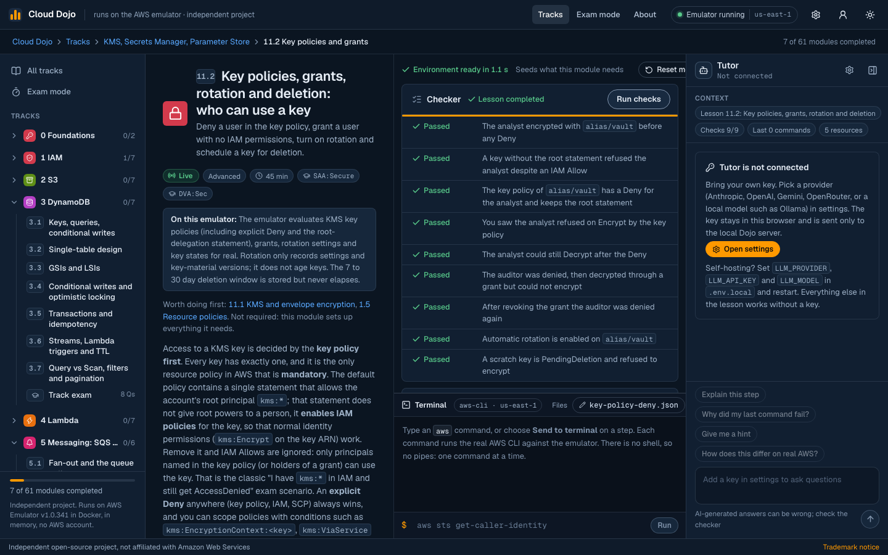

### Capstone: Snap Notes, production-shaped

Build a small serverless app from a spec card: a Cognito JWT on the API, a FIFO edits queue with a DLQ, a Step Functions moderation workflow with retry and catch, a Lambda-errors alarm to SNS, an SSE-KMS bucket with Block Public Access, and one least-privilege role per function. The checker is scored as a **mini Well-Architected review, one row per pillar** (Operational Excellence, Security, Reliability, Performance Efficiency, Cost Optimization, Sustainability), with the sub-checks behind each row. **Show me** builds it step by step.

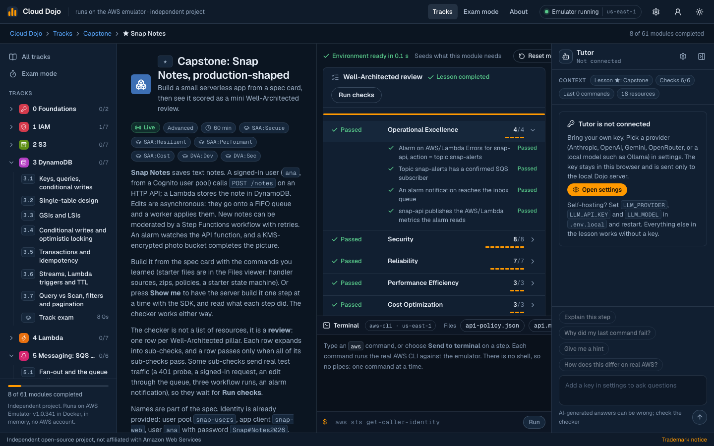

### Exam mode and readiness

A **mixed, timed practice exam** drawn from every track exam, tagged by SAA domain (Secure, Resilient, Performant, Cost) and DVA domain (Dev, Sec, Deploy, Troubleshoot). Pick SAA, DVA or Mixed, a length and a pace (or untimed); flag questions for review; get the score, a **per-domain readiness view**, and a **review of wrong answers** with the explanation and a link back to the module to study. The answer key never reaches the browser before you submit. Each question counts once toward readiness, as its latest result.

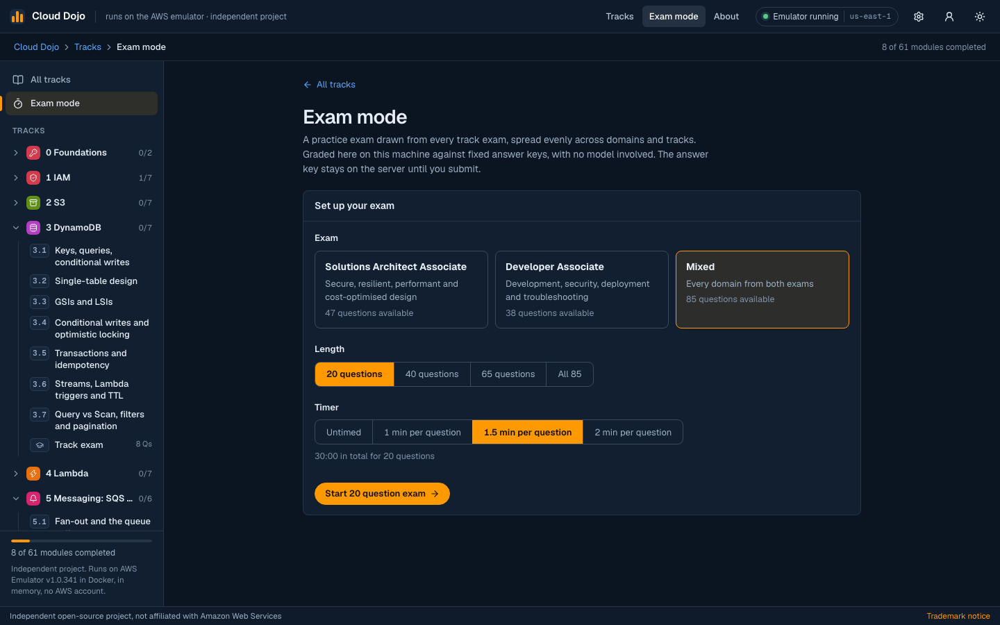

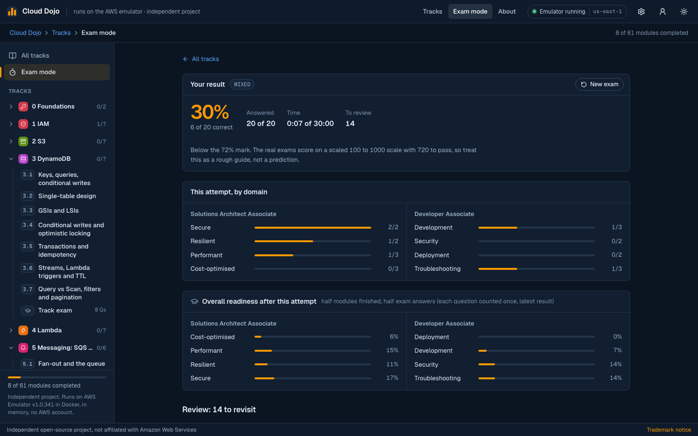

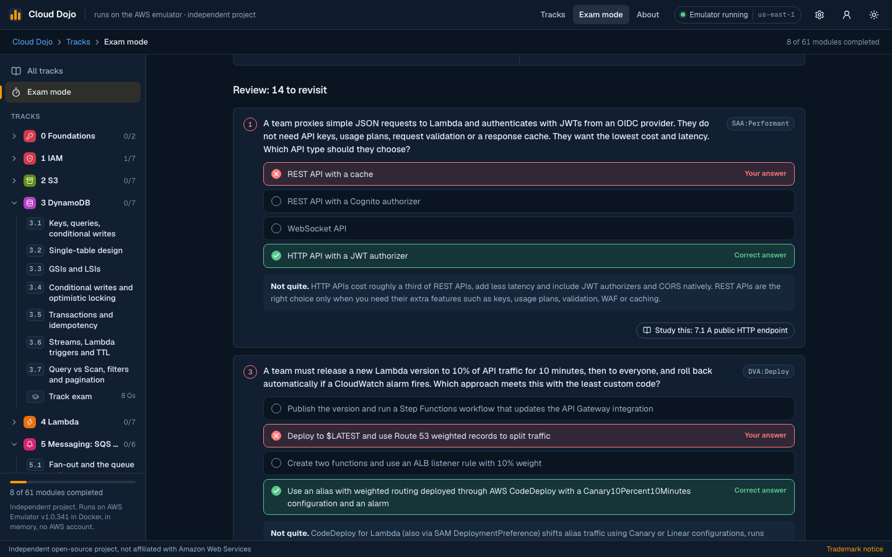

### Honesty badges and the capability probe

- **Live**: the emulator enforces it and the checker probes the real behaviour.
- **Simulated**: taught through an AWS evaluation API such as `simulate-principal-policy`, or static checks of your JSON (permission boundaries, lifecycle rules, Logs Insights if the probe ever fails).
- **Concept**: diagram, quiz and a real-AWS note, with no hands-on claim (tag-based access control, Lambda async destinations).

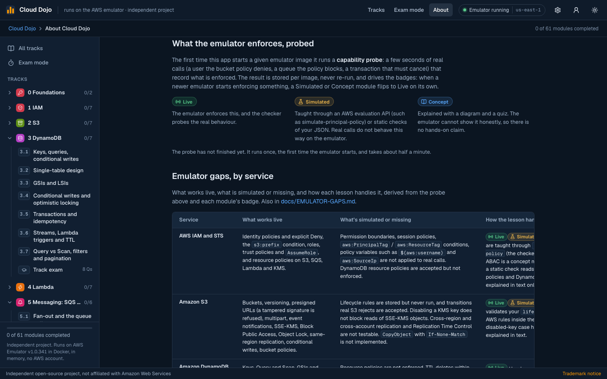

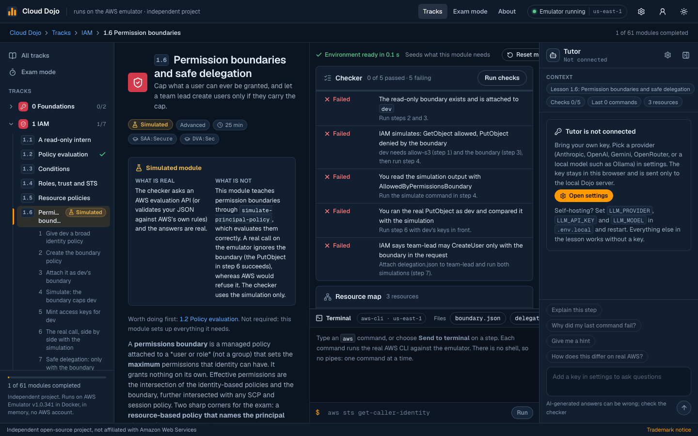

**Honest emulator gaps (tested on v1.0.341)**. Derived from the capability probe and each module's badge; the same table lives in [docs/EMULATOR-GAPS.md](docs/EMULATOR-GAPS.md) and on the About page.

<!-- gaps:begin (generated by scripts/gen-gaps.ts from shared/gaps.ts) -->
| Service | What works live | What's simulated or missing | How the lesson handles it |
|---|---|---|---|
| AWS IAM and STS | Identity policies and explicit Deny, the `s3:prefix` condition, roles, trust policies and `AssumeRole`, and resource policies on S3, SQS, Lambda and KMS. | Permission boundaries, session policies, `aws:PrincipalTag` / `aws:ResourceTag` conditions, policy variables such as `${aws:username}` and `aws:SourceIp` are not applied to real calls. DynamoDB resource policies are accepted but not enforced. | **Live** · **Simulated** · **Concept**: Boundaries are taught through `simulate-principal-policy` (the checker uses the simulation only). ABAC is a concept module: you write the policy, a static check reads it, a quiz grades it. Session policies and DynamoDB resource policies are explained in text only. |
| Amazon S3 | Buckets, versioning, presigned URLs (a tampered signature is refused), multipart, event notifications, SSE-KMS, Block Public Access, Object Lock, same-region replication, conditional writes, bucket policies. | Lifecycle rules are stored but never run, and transitions real S3 rejects are accepted. Disabling a KMS key does not block reads of SSE-KMS objects. Cross-region and cross-account replication and Replication Time Control are not testable. `CopyObject` with `If-None-Match` is not implemented. | **Live** · **Simulated**: The lifecycle module validates your `lifecycle.json` against the real AWS rules inside the app (Simulated). The disabled-key case has no hands-on step and is explained in text. |
| Amazon DynamoDB | Keys, Query and Scan, GSIs and LSIs (consistent reads on a GSI are refused), conditional writes, all-or-nothing transactions, streams with a Lambda trigger, TTL. | Resource policies are not enforced. TTL deletes within about 15 seconds here; on AWS it takes hours to days. | **Live**: Hands-on and checked for real. The resource-policy exception and the real TTL delay are stated in the module and in IAM 1.5. |
| AWS Lambda | Configuration, errors, timeouts and log tails, versions and weighted aliases (published versions are immutable), layers, reserved concurrency and throttling, function URLs, resource policies, SQS event source mappings with partial batch responses. | Every invoke gets a fresh sandbox, so cold versus warm starts and real latency cannot be shown. Provisioned concurrency is cosmetic. Async destinations and DLQ settings are accepted but nothing is delivered. A function URL opens after one statement (AWS needs two) and is an emulator address. Invokes do not create CloudWatch log groups. | **Live** · **Concept**: Async destinations is a concept module (static review of your JSON plus a quiz); hands-on failure handling moves to the SQS redrive module. The other gaps are named in the module text. |
| Amazon SQS and SNS | Visibility timeouts, dead-letter queues with redrive, FIFO deduplication, SNS filter policies and fan-out, queue access policies. | Scaling behaviour under heavy load is not representative. | **Live**: Hands-on and checked for real; load behaviour is not claimed anywhere. |
| Amazon API Gateway | HTTP API routes, stages and auto-deploy, Lambda authorizers, Cognito-style JWT authorizers (issuer, audience, scopes), stage throttling (429), CORS headers, REST API keys and usage-plan quotas. | The Lambda invoke permission for API Gateway is not enforced. A missing stage answers 403, not 404, and a CORS preflight answers 404 where AWS answers 204. The JWT issuer is the emulator address. Fidelity for the REST API is not published. | **Live**: Hands-on. Each module says which status codes differ and tells you to read the headers, not the status. |
| AWS Step Functions | Standard executions, Retry and Catch, inline Map, Choice, Wait, the DynamoDB service integration, callbacks with task tokens, Express machines, JSONata. | The state machine role's trust policy is not checked at create time. Distributed Map does not run. `test-state` on a Task state needs a mock. `TaskDoesNotExist` cannot be produced from the CLI. | **Live**: Hands-on. Distributed Map is described, not run; the `test-state` module tests Pass and Choice states only. |
| Amazon EventBridge and Scheduler | Custom buses, patterns, `test-event-pattern`, targets with their role or resource-policy checks, one-off and recurring schedules that really fire, archive and replay. | No gap found by the probe or while building the modules. | **Live**: Hands-on; archive and replay is re-checked by a probe on every emulator image. |
| Amazon CloudWatch and Logs | Custom metrics, statistics, percentiles and metric math, alarms that evaluate on their own and publish to SNS, metric filters, Logs Insights queries, stored dashboards. | There is no console, so the app draws the stored dashboard itself. Dashboard body validation is partial. | **Live** · **Simulated**: The Logs module is declared Simulated and shows Live while both of its probes pass (they did on 1.0.341); if an emulator update breaks either probe it falls back to Simulated on its own. |
| AWS KMS, Secrets Manager and Parameter Store | Symmetric keys, aliases, data keys, encryption context, key policies and grants, secret versions and staging labels, rotation that really invokes your Lambda, SecureString parameters. | Rotation only records settings and does not age keys; the deletion window never elapses. A rotated secret keeps its `AWSPENDING` label. IAM is not evaluated on `ssm:` actions. | **Live**: Hands-on. No module relies on IAM for Parameter Store, and the gaps are named in the module text. |
| The emulator as a whole | AWS-shaped APIs and real AWS error codes, started in about a second, with a clean slate on every restart. | In memory only (no persistence, no reset API), one account (`000000000000`) and one Region, not built for load or long-running use, and not a security test. The version is pinned (v1.0.341) because it ships many releases a day. Services outside the course are out of scope (published fidelity: CloudFormation 16%, EC2 45%). | —: Reset module restarts the emulator and rebuilds the module's baseline. Nothing here should be used to verify production security. |
<!-- gaps:end -->

### Progress, editor and probes

- **Progress** is local-first: a JSON file in the data folder (`~/.cloud-dojo/progress.json`, or `CLOUD_DOJO_DATA_DIR`; the old name `ACADEMY_DATA_DIR` is still read) holds, per module, checks passed, break-it seen, predict answers and time; per track, the exam; per domain, readiness. The home page has **Continue where you left off**. The Progress menu in the header has **Export progress** and **Import progress** (JSON; merge or replace). Exports hold learning progress only, never keys or settings.
- **Mark as done / Undo.** Every module has a **Mark as done** button (lesson page and track list). The app tells **Verified** (the checker confirmed it) from **Marked by you** (`manual: true` in the file, also in exports and the merge rule). **Undo** works on both: it clears the completed mark and keeps the checks you passed.
- **Passed earlier.** Switching module or restarting the server resets the emulator, so live checks read empty. Checks you passed before show as *passed earlier* with a note that the sandbox was reset and your progress is safe.
- **Safer saves.** Progress is written to a temp file and renamed into place, with the previous version kept as `progress.json.bak` (a corrupt file is set aside and recovered from the `.bak`). On start the server logs the data folder, and if `~/.aws-academy/progress.json` is newer than `~/.cloud-dojo/progress.json` it is merged in with the import rule (idempotent; the old folder is only read).
- **Starter-file editor**: files a module marks editable open in a small editor in the workbench. The server writes only plain-named text files inside that module's own working folder, and rebuilds Lambda zips from edited sources.
- **HTTP probe**: method, headers and body, to the emulator's origin only. The `aws` runner is unchanged and still `aws`-only.

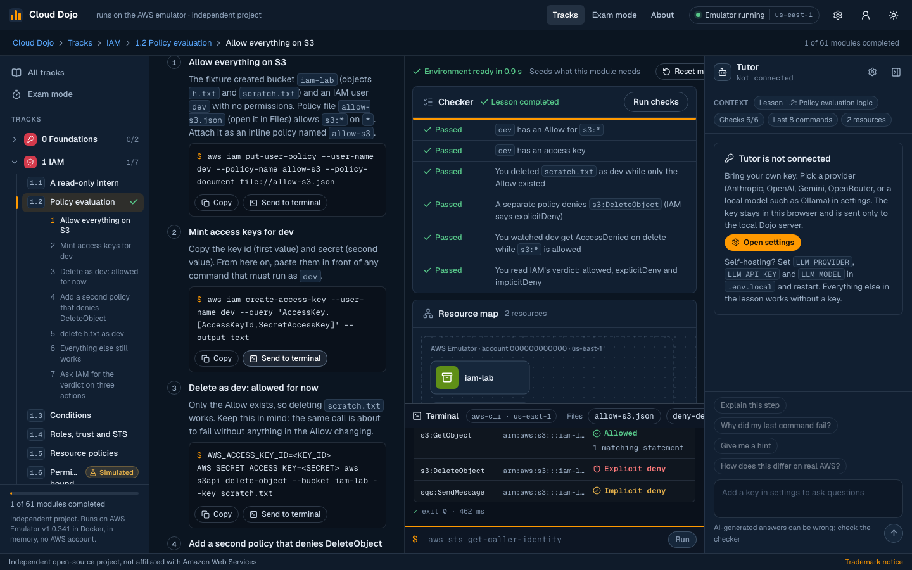

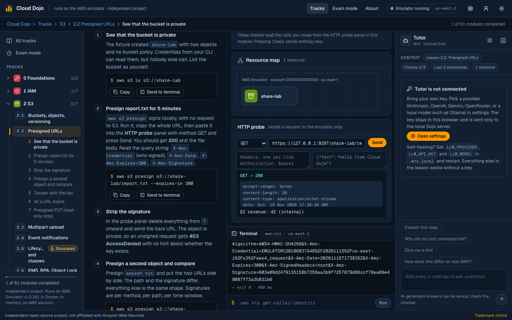

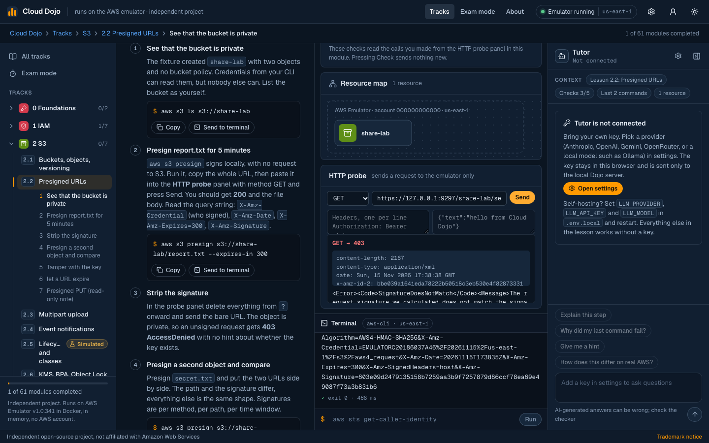

## Run it

```bash
bun install && bun run dev      # development: API on :4747, UI on :5173
bun run start                   # build the UI and serve everything from http://127.0.0.1:4747
bun run emulator:stop           # remove the emulator container (Ctrl+C does this too)
```

Or with Docker for the app itself (experimental):

```bash
docker compose up --build       # http://127.0.0.1:4747 on a Linux host
```

The app starts the emulator as a sibling container through the mounted Docker socket and uses host networking so both are reachable on `127.0.0.1`. Verified: the image builds and, inside it, the server boots the emulator and reports it ready. **Not verified on macOS**: Docker Desktop does not publish host-network ports to the Mac by default, so from the browser it was unreachable in our test; on macOS use `bun install && bun run dev`.

The first run builds the pinned image `cloud-dojo-emulator:1.0.341` from `emulator/Dockerfile` (it downloads AWS's package). It targets linux/arm64; on an x86 machine change the `aarch64` rpm to `x86_64` and `--platform` accordingly. The container listens on `127.0.0.1:9297` with telemetry off and a 2 GiB cap. Configuration: `EMULATOR_CONTAINER`, `EMULATOR_PORT`, `CLOUD_DOJO_DATA_DIR`, `PORT`. See [.env.example](.env.example).

### Tutor chat (optional, bring your own key)

The tutor is provider-agnostic. Open **Settings** (gear icon in the top bar or the tutor panel), pick a provider (**Anthropic, OpenAI, Google Gemini, OpenRouter**, or any **OpenAI-compatible endpoint** with a custom base URL, which covers local Ollama and LM Studio), type a model name (a sensible default is prefilled), paste your API key and press **Test connection**.

- The key is stored **only in your browser** (localStorage on this device). **Forget key** removes it.
- It is sent to the local Bun server in a request header for each call, used for that one upstream request, and **never logged, persisted, echoed back, or included in errors, progress, exports or the tutor context**. Tests assert this with a sentinel key.
- Self-hosters can set `LLM_PROVIDER`, `LLM_API_KEY`, `LLM_MODEL`, `LLM_BASE_URL` in `.env.local` instead (the legacy `ANTHROPIC_API_KEY` still works). A key typed in the browser takes precedence.
- Without a key the panel explains how to enable it, and the rest of the app works unchanged.

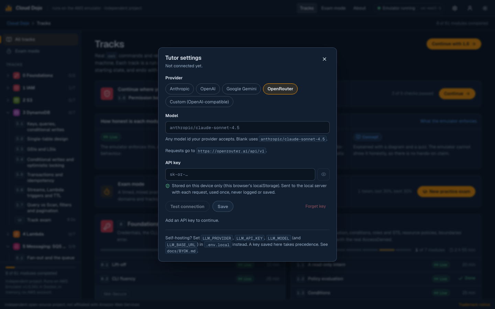

Details: [docs/BYOK.md](docs/BYOK.md). The tutor sees the module text, goal and steps, which checks pass, your last ten commands and outputs (truncated), and a snapshot of the resource map. It suggests commands as copyable blocks with **Send to terminal**, which only pre-fills the terminal; you press run.

## Safety design

- The runner executes only the `aws` binary with no shell; pipes, `&&`, `$()` and redirects are rejected.
- The child environment is built from scratch (never `process.env`), with a throwaway `HOME`, so your real AWS credentials, `AWS_PROFILE` and LLM API keys cannot leak into a lesson. `--profile`, `--endpoint-url`, `--no-verify-ssl`, `--ca-bundle`, `aws configure set`, `sso`, `login` and paths outside the lesson folder are refused. Inline keys must start with `EMULATOR`.
- The emulator regenerates its keys and certificate on every start. The CLI gets `AWS_CA_BUNDLE`, SDK clients get a per-connection `https.Agent({ ca })`. TLS verification is never disabled globally.
- The HTTP probe can only reach the emulator's origin. The API server binds `127.0.0.1` and refuses cross-site POSTs.

## Tests

```bash
bun test            # runner env-scrubbing, command parsing, tutor providers + key-never-leaks, module integrity, quiz grading, exam mode, progress export/import, editor and probe guards
bun run lint
bun run build
bun run test:e2e    # needs Docker: every module on a fresh emulator, red before, green after; capstone scored; quizzes graded
bun run capture     # builds, starts the server, records screenshots + walkthrough video into docs/
```

**Test runs never touch your real session.** Your dev server owns ports **4747** (API) and **5173** (Vite), and your live lab is the `cloud-dojo-emulator` container on **9297**. Everything automated uses **4848** (API), **5274** (Vite) and a dedicated emulator (`cloud-dojo-emulator-test` on **9298**) with a temp data folder: `bun run test:e2e`, `bun run capture` and `bun run dev:test` go through `scripts/with-temp-data.ts`, which sets the ports and emulator, and a server on a custom data folder refuses to bind 4747 or to use the learner's container name or port 9297. Such a server also reports its data folder (`/api/info`, `/api/status`) and the UI shows a **Test data folder** banner; if the server restarts while a tab is open, the UI says so. You can still run several emulators side by side with `CLOUD_DOJO_EMULATOR_NAME` and `CLOUD_DOJO_EMULATOR_PORT` (the older `EMULATOR_CONTAINER` / `EMULATOR_PORT` names still work).

**Tests never touch your real progress.** `bun test` preloads a throwaway data folder (`tests/setup.ts`), and `test:e2e` and `capture` run through `scripts/with-temp-data.ts`, which creates a fresh `mkdtemp` folder, points `CLOUD_DOJO_DATA_DIR` at it and deletes it afterwards. The e2e and capture scripts refuse to start against `~/.cloud-dojo` or `~/.aws-academy`. Like any run of the app, they need an emulator (Docker) and no real AWS credentials: use dummy ones and `AWS_ENDPOINT_URL` pointing at the emulator if your shell has a real profile.

## Layout

```
server/      Bun API: emulator manager, runner, clients, inventory, tutor + LLM providers, progress, exam mode, capability probes, file editor, modules (fixtures + checkers)
shared/      tracks, module content, exams and wire types (no SDK imports)
src/         React app: track grid, manual, predict and quiz, exam mode, editor, terminal, resource map, checks, mini dashboard, tutor, settings, About
emulator/    pinned Dockerfile
scripts/     dev, e2e (per track), capture
docs/        screenshots, walkthrough video, EMULATOR-GAPS.md, BYOK.md, OPEN-SOURCE-NOTES.md
PRODUCT.md, DESIGN.md, PLAN.md, SECURITY.md, CONTRIBUTING.md, CHANGELOG.md, LICENSE
```

## Credits and trademarks

Cloud Dojo is MIT licensed (see [LICENSE](LICENSE)). Contributions: [CONTRIBUTING.md](CONTRIBUTING.md). Security and key handling: [SECURITY.md](SECURITY.md).

- **AWS Emulator** is published by AWS under the CC0-1.0 license (vendored parts Apache-2.0). Cloud Dojo does not bundle or redistribute it: `emulator/Dockerfile` downloads AWS's own package onto your machine when you build the image. Details and open questions: [docs/OPEN-SOURCE-NOTES.md](docs/OPEN-SOURCE-NOTES.md).
- Names of AWS services (Amazon S3, AWS Lambda, Amazon DynamoDB and so on) are used only to say which service a lesson is about. The UI uses its own icons and the public AWS category colours; no AWS logo, architecture icon or the AWS smile mark is used.
- Cloud Dojo is an independent open-source project. It is not affiliated with, endorsed by, or sponsored by Amazon Web Services, Inc. or its affiliates. Amazon Web Services, AWS, and the names of AWS services are trademarks of Amazon.com, Inc. or its affiliates.

### Renamed from "AWS Academy"

This project was called "AWS Academy" until 2026-11-15; see [CHANGELOG.md](CHANGELOG.md). Your data is carried over (copied, never moved) from `~/.aws-academy`, old progress exports still import, and `ACADEMY_DATA_DIR` still works.

## Validation artifacts

- Video: [docs/walkthrough.mp4](docs/walkthrough.mp4) (About, track grid, IAM 1.2, boundaries, ABAC, Step Functions, API Gateway JWT, EventBridge, CloudWatch alarm and dashboard, KMS, capstone v2 review, exam mode with readiness, BYOK settings).
- Screenshots in [docs/](docs/).

## License

[MIT](LICENSE) © 2026 Danny Avraham Shore.
